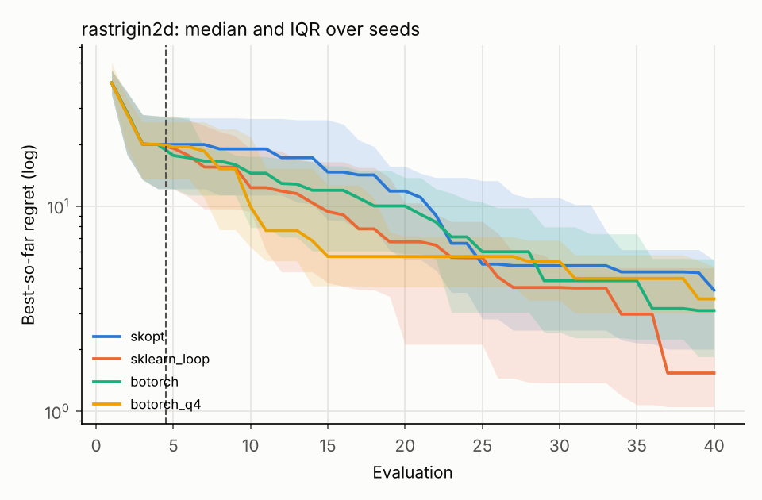
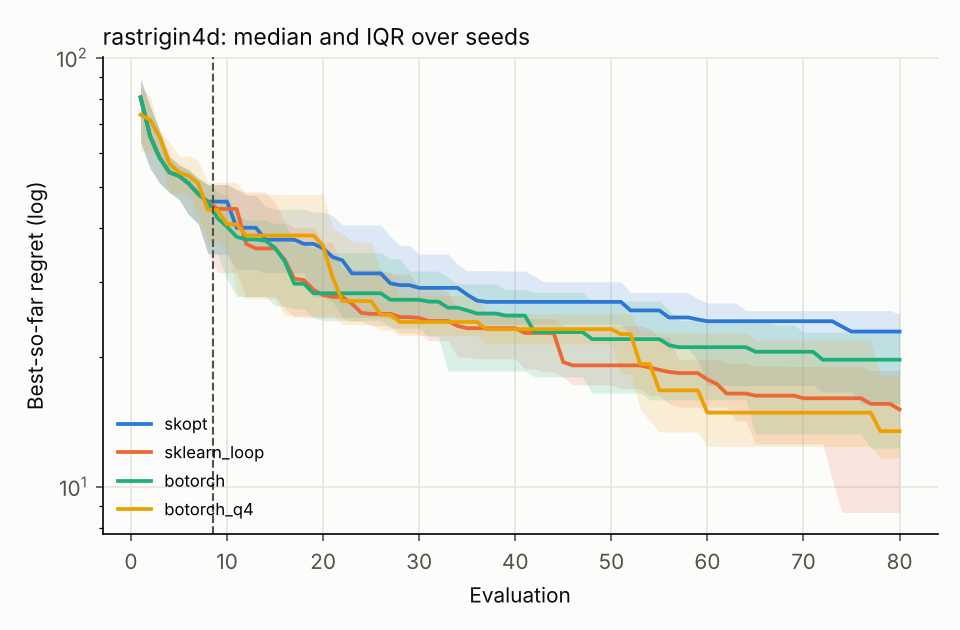
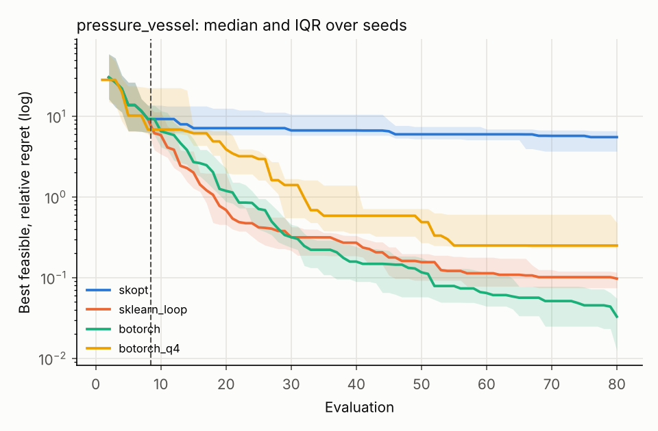
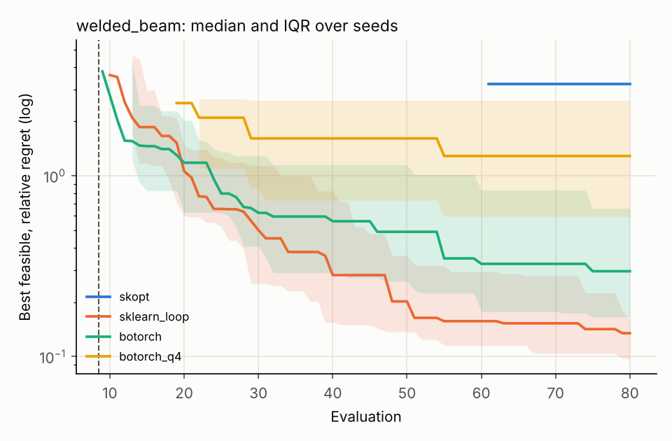

# skopt vs BoTorch: results

### rastrigin2d (d=2, budget=40, best known 0)

Final best feasible objective, median [25th, 75th percentile] over seeds. `p vs skopt` is a two-sided Mann-Whitney U test on the final values. Time is median wall-clock seconds per run on one CPU thread (`botorch_mps`: on the GPU).

| method | seeds | final | median relative/abs. regret | p vs skopt | feasible at end | time (s) |
| :--- | ---: | :--- | ---: | ---: | ---: | ---: |
| skopt | 20 | 3.9 [2.01, 5.46] | 3.9 |  | 20/20 | 2.6 |
| sklearn_loop | 20 | 1.54 [1.05, 5.01] | 1.54 | 0.156 | 20/20 | 0.4 |
| botorch | 20 | 3.1 [1.85, 5.53] | 3.1 | 0.776 | 20/20 | 8.2 |
| botorch_q4 | 10 | 3.53 [3.01, 5.08] | 3.53 | 0.843 | 10/10 | 17.2 |

### rastrigin4d (d=4, budget=80, best known 0)

Final best feasible objective, median [25th, 75th percentile] over seeds. `p vs skopt` is a two-sided Mann-Whitney U test on the final values. Time is median wall-clock seconds per run on one CPU thread (`botorch_mps`: on the GPU).

| method | seeds | final | median relative/abs. regret | p vs skopt | feasible at end | time (s) |
| :--- | ---: | :--- | ---: | ---: | ---: | ---: |
| skopt | 20 | 23 [15.6, 25.2] | 23 |  | 20/20 | 15.6 |
| sklearn_loop | 20 | 15.1 [8.7, 18.6] | 15.1 | 0.004 | 20/20 | 1.8 |
| botorch | 20 | 19.8 [12.3, 22.9] | 19.8 | 0.229 | 20/20 | 23.7 |
| botorch_q4 | 10 | 13.5 [11.6, 18.1] | 13.5 | 0.050 | 10/10 | 57.5 |

### pressure_vessel (d=4, budget=80, best known 5885.33)

Final best feasible objective, median [25th, 75th percentile] over seeds. `p vs skopt` is a two-sided Mann-Whitney U test on the final values. Time is median wall-clock seconds per run on one CPU thread (`botorch_mps`: on the GPU).

| method | seeds | final | median relative/abs. regret | p vs skopt | feasible at end | time (s) |
| :--- | ---: | :--- | ---: | ---: | ---: | ---: |
| skopt | 20 | 3.84e+04 [2.76e+04, 4.48e+04] | 5.52 |  | 20/20 | 15.5 |
| sklearn_loop | 20 | 6.46e+03 [6.33e+03, 6.57e+03] | 0.0974 | 0.000 | 20/20 | 5.0 |
| botorch | 20 | 6.08e+03 [5.96e+03, 6.21e+03] | 0.0329 | 0.000 | 20/20 | 151.3 |
| botorch_q4 | 10 | 7.36e+03 [7.27e+03, 8.71e+03] | 0.251 | 0.000 | 10/10 | 286.4 |

### welded_beam (d=4, budget=80, best known 1.72485)

Final best feasible objective, median [25th, 75th percentile] over seeds. `p vs skopt` is a two-sided Mann-Whitney U test on the final values. Time is median wall-clock seconds per run on one CPU thread (`botorch_mps`: on the GPU).

| method | seeds | final | median relative/abs. regret | p vs skopt | feasible at end | time (s) |
| :--- | ---: | :--- | ---: | ---: | ---: | ---: |
| skopt | 20 | 7.29 [3.57, ∞] | 3.23 |  | 11/20 | 16.9 |
| sklearn_loop | 20 | 1.96 [1.89, 2] | 0.135 | 0.000 | 20/20 | 8.6 |
| botorch | 20 | 2.24 [2.01, 2.86] | 0.297 | 0.000 | 20/20 | 229.5 |
| botorch_q4 | 10 | 3.94 [2.75, 6.23] | 1.29 | 0.066 | 9/10 | 990.2 |

